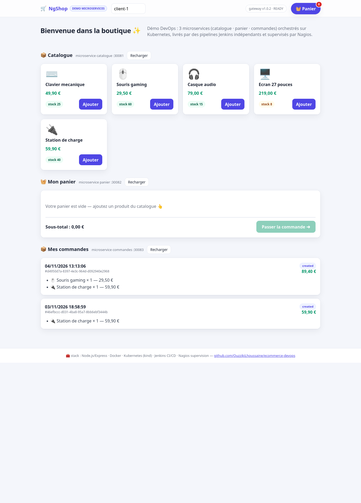
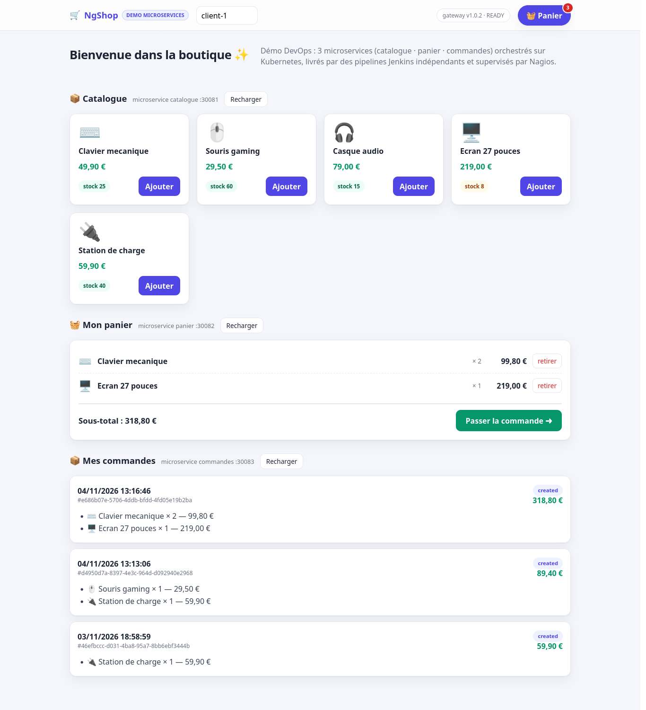
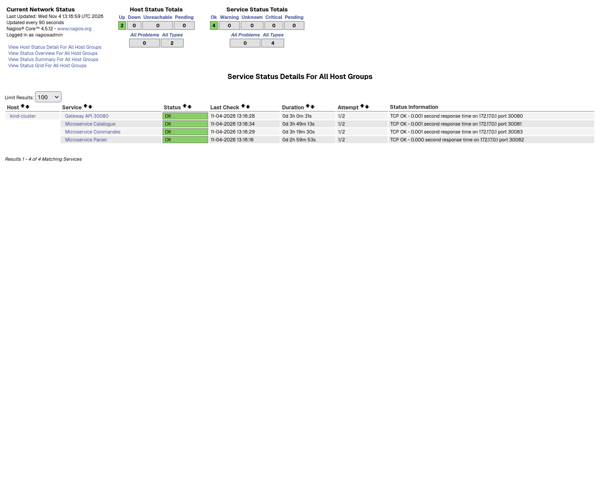
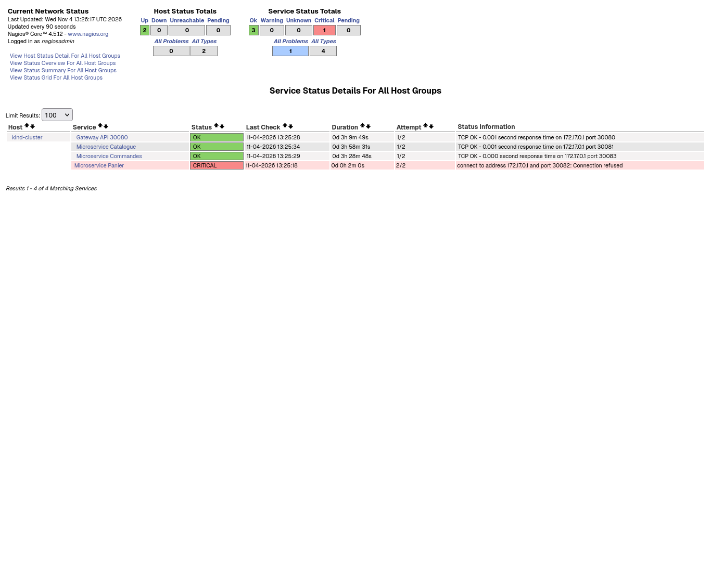

# Démonstration — soutenance DevOps II

**Plateforme e-commerce microservices** · Groupe 2 · ≈ 15 minutes

| | |
|---|---|
| **Objectif** | Montrer en direct : Git ↔ Jenkins ↔ Docker ↔ Kubernetes ↔ Nagios, et surtout **la mise à jour d'un microservice sans les autres** |
| **Réf. énoncé** | `Group-2.pdf` — « Plateforme e-commerce simplifiée » |
| **Docs liées** | `RAPPORT.md` (justifications) · `README.md` (installation) |

Chronologie prête à l'emploi : cochez physiquement les étapes pendant la répétition.

**Checklist 24 h avant** : cluster kind up · Jenkins jobs verts · Nagios 4×OK · boutique http://localhost:30080 · comptes de démonstration pré-crées (panier + commande)

## 0. Avant l'arrivée du jury — préparation (10 min)

Vérifier que tout tourne. Si la machine vient d'être redémarrée :

```bash
cd ~/ecommerce-devops

# 1) cluster kind + registre + namespace      (si absent: kind get clusters)
kind get clusters
kubectl -n ecommerce get pods                 # 8 pods en RUNNING et 1/1 READY

# 2) les stacks annexe
docker ps --filter name=nagios --filter name=jenkins-devops

# 3) fumeurs rapides
curl -s http://localhost:30080/healthz        # {"status":"ok","service":"gateway"}
curl -s http://localhost:30080/api/catalogue/products | head -c 120

# ajouter un article au panier (pour l'historique de la boutique)
curl -s -X POST http://localhost:30080/api/panier/cart/items \
  -H x-user-id:demo-client -H content-type:application/json \
  -d '{"productId":"P-001"}'

# 4) ouvrir les onglets :
#    - Boutique    : http://localhost:30080
#    - Jenkins     : http://localhost:8081  (admin / devops-2026)
#    - Nagios      : http://localhost:8082/nagios (nagiosadmin / nagios-admin)
#    - Terminal pret : terminal avec repo git + kubectl
```

**Jenkins** : `admin / devops-2026` (réinitialisable via `infra/jenkins/reset-admin.groovy`)

### Aperçu de la boutique (captures réelles de l'interface livrée par Jenkins)


*Interface NgShop servie par la gateway (v1.0.2) : catalogue depuis le microservice catalogue, panier et historique depuis panier/commandes — tous trois derrière le point d'entrée unique :30080.*


*Panier rempli (badge 3, sous-total 318,80 €) et commandes déjà enregistrées par le microservice commandes.*

---

## 1. Le projet & l'architecture (2 min)

Dans un terminal :

```bash
cd ~/ecommerce-devops && tree -L 3 -I node_modules
```

- 4 services (3 microservices + gateway), chacun avec Dockerfile + k8s/ + Jenkinsfile + VERSION
- Une base MongoDB **dédiée** par microservice (StatefulSets `mongo-<svc>`)

Tableau récapitulatif de l'architecture → voir `RAPPORT.md`.

---

## 2. Git — gestion du code (1 min)

```bash
cd ~/ecommerce-devops && git log --oneline | head -10
cat services/catalogue/VERSION          # 2.0.0
git remote -v                            # https://github.com/OuzzikiLhoussaine/ecommerce-devops
```

Points à montrer : **repo unique**, un fichier `VERSION` **par microservice** (cycle de version
indépendant), l'historique qui documente les évolutions.

---

## 3. Jenkins — 4 pipelines indépendants (3 min)

Onglet Jenkins : les 4 jobs (`catalogue`, `panier`, `commandes`, `gateway`).

- **Historique de builds** : chacun a ses builds green indépendants.
- Cliquez un build → **Pipeline Steps / Console Output** : montrer les 5 stages :
  `Resolve version → Tests → Build image → Push registre → Deploy Kubernetes`.
- Réinterpréter le **défi technique** de l'énoncé : *chaque pipeline déploie son
  service et ne touche jamais aux autres (aucun `apply` croisé, aucune `set image` croisée).*
- Le fichier déclencheur : `services/<svc>/Jenkinsfile` + version lue dans `services/<svc>/VERSION`.

Déclencher manuellement un build de **catalogue** (bouton *Build Now*) pour la suite.

---

## 4. Docker — build & publication des images (1,5 min)

Pendant que le build tourne, montrer :

```bash
curl -s http://localhost:5000/v2/_catalog                                # registre local
curl -s http://localhost:5000/v2/ecommerce/catalogue/tags/list
docker images | grep ecommerce
```

Puis dans la console Jenkins : **"Push registre"** → digests poussés du build en cours.

---

## 5. LE point clé : mise à jour du catalogue SANS les autres (4 min)

**Étape 1** — préparer l'écoute des pods dans un terminal (garder à l'écran) :

```bash
watch -n1 kubectl -n ecommerce get pods -o wide
```

Noter les pods `panier-…` et `commandes-…` (âge, nom). Exemple réel observé
pendant la préparation :

```
commandes-7495fcc947-xxgxj   1/1 Running   3 (101m ago)   133m   ← inchangé
panier-55bd5ddbff-xz7s9      1/1 Running   0              82m    ← inchangé
```

**Étape 2** — passer Catalogue en version 2 et pousser :

```bash
echo 3.0.0 > services/catalogue/VERSION
git -C ~/ecommerce-devops commit -am "catalogue v3.0.0"
git push        # (ou bouton Build Now pour forcer immédiatement)
```

Jenkins suit `pollSCM('H/5 * * * *')` — pour aller vite pendant la démo, cliquez
*Build Now* sur `catalogue`.

**Étape 3** — vérifier dans la vue `watch` :

- le pod `catalogue-…` se recrée (nouveau nom, âge en secondes)
- `panier-…` / `commandes-…` **gardent leurs noms et leurs âges** → jamais redéployés
- `deployment/catalogue` image = `…/catalogue:v3.0.0-<build>`

```bash
kubectl -n ecommerce get deploy catalogue \
  -o jsonpath='{.spec.template.spec.containers[0].image}'; echo
curl -s http://localhost:30081/healthz        # version: "2.0.0" (ou 3.0.0)
```

**Étape 4** — l'application reste fonctionnelle pendant/après :
boutique http://localhost:30080 → ajouter au panier → commander → historique
(captures réelles ci-dessus, section Aperçu).

---

## 6. Kubernetes — orchestration (1,5 min)

```bash
kubectl get ns
kubectl -n ecommerce get deploy,sts,svc
kubectl -n ecommerce get pods
kubectl -n ecommerce describe deploy catalogue | grep -A6 "Environment\|Probe" | head -20
```

À souligner : probes `liveness=/healthz` / `readiness=/readyz`, 3 NodePorts
(30081-30083) + gateway 30080, StatefulSets + PVC pour les bases de données.

---

## 7. Nagios — supervision individuelle (2,5 min)

Onglet Nagios : http://localhost:8082/nagios (login `nagiosadmin` / `nagios-admin`).

- Menu **Services** : les 4 checks (Catalogue 30081, Panier 30082, Commandes 30083,
  Gateway 30080) tous **OK**.
- Cliquer un service → durée, sortie du check (TCP OK port 300XX).


*Capture réelle de la carte Nagios : 4 services supervisés individuellement, tous OK (`TCP Ok` sur chaque NodePort).*

### 7.bis Alerte en live

```bash
kubectl -n ecommerce scale deployment/panier --replicas=0
```

→ 1 à 2 min plus tard, dans Nagios : **« Microservice Panier » → CRITICAL**
(2 tentatives × 1 min, `max_check_attempts 2`).
Montrer que Catalogue/Commandes/Gateway restent OK grâce à la gateway
"tolérante aux pannes" (readiness indépendante des services amonts).

Capture réelle de cet état (impossible à figer en live, remise en état juste après) :


*Alerte active : « Microservice Panier » **CRITICAL** (tentatives 2/2, `connect to address 172.17.0.1 and port 30082: Connection refused`) — le total du haut passe à **1 Critical**, tandis que les 3 autres services restent verts : l'alerte est bien **isolée à un seul microservice**.*

### 7.3 Retour à l'état normal

```bash
kubectl -n ecommerce scale deployment/panier --replicas=1
```

→ Nagios repasse **OK** (notification de récupération visible dans *Events* / log).

Capture réelle de la récupération :


*Récupération : les 4 services sont à nouveau OK (0 Critical), la durée fraîche (`0d 0h 5m 46s`) du service panier montre qu'il vient de sortir de l'alerte.*

Logs côté serveur si besoin :

```bash
docker exec nagios grep "SERVICE ALERT" /opt/nagios/var/nagios.log | tail -5
```

---

## 8. Questions prévisibles du jury — réponses

| Question | Réponse courte |
|---|---|
| Pourquoi une base par service ? | Isolation des données, panne non propagée, schémas/scalabilité indépendants (détails dans RAPPORT.md §3) |
| Pourquoi `VERSION` + `-b<build>` dans le tag ? | Cycle de version par microservice + traçabilité du build qui a produit l'image |
| Comment devient-on autonome pour redéployer un service ? | `kubectl set image` ciblé sur **son** deployment, appliqué depuis **son** pipeline |
| Comment fonctionnent les alertes Nagios ? | `check_tcp` sur les NodePorts, seuils : intervalle 1 min, 2 tentatives → HARD CRITICAL, notification toutes les 5 min |
| Que se passe-t-il si Mongo tombe ? | `/readyz` renvoie 503 → pod NotReady → le pod d'application redémarre dès la reconnexion (boucle de retry au démarrage) |
| Les données sont-elles persistées ? | Oui, via PVC (StatefulSet + volumeClaimTemplates 1 GiB, storageClass `standard`) |

---

## 9. Plan B — si l'environnement doit être reconstruit devant le jury

```bash
make down && make cluster-up && make push-all && make deploy-all && sleep 60
make jenkins-up && make nagios-up
```

(≈ 10 min à la 1re exécution à cause du pull `kindest/node`.)
Les images restent en cache docker → build rapide au re-démarrage.
