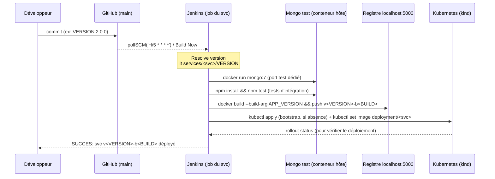

<h1 align="center">🛒 NgShop — Plateforme e-commerce simplifiée</h1>
<p align="center">
  <b>Rapport technique</b> · Module&nbsp;DevOps&nbsp;II · Mini-projet · Groupe&nbsp;2
</p>

| | |
|---|---|
| 🏫 **Établissement** | Université Abdelmalek Essaâdi · Faculté polydisciplinaire de Larache |
| 🔗 **Repository** | https://github.com/OuzzikiLhoussaine/ecommerce-devops |
| 📚 **Documents liés** | `README.md` (installation) · `DEMO.md` (checklist de soutenance) |

     

---

**Sommaire**

1. [Introduction et objectifs](#1-introduction-et-objectifs)
2. [Architecture générale](#2-architecture-générale)
3. [Les 4 services du projet](#3-les-4-services-du-projet)
4. [Versionning & déploiement indépendant](#4-gestion-des-versions--la-stratégie-de-déploiement-indépendant)
5. [CI/CD Jenkins — détails](#5-cicd-jenkins--détails)
6. [Déploiement Kubernetes](#6-déploiement-kubernetes--manifestes)
7. [Supervision Nagios](#7-supervision-nagios)
8. [Difficultés rencontrées](#8-difficultés-rencontrées-et-résolutions-valeur-ajoutée)
9. [Améliorations futures](#9-améliorations-futures)
A. [Annexe A — URLs et identifiants](#annexe-a--urls-et-identifiants)
B. [Annexe B — Installation](#annexe-b--commandes-résumées-dinstallation)

---


## 1. Introduction et objectifs

L'objectif du projet est de développer une **plateforme e-commerce simplifiée fondée
sur une architecture microservices** et de mettre en oeuvre la chaîne DevOps complète :

- trois microservices indépendants (**Catalogue**, **Panier**, **Commandes**) ;
- un **point d'entrée unique** (API Gateway) ;
- une **chaîne CI/CD Jenkins** dédiée à chaque microservice ;
- la **conteneurisation Docker** et l'**orchestration Kubernetes** ;
- la **supervision Nagios** avec alertes.

Le déf technique central est le **déploiement indépendant** : montrer que la mise à
jour de la version 2 du microservice Catalogue est possible **sans redéployer** les
microservices Panier et Commandes (pods inchangés, vérifiable à l'oeil avec
`kubectl get pods -w`).

---

## 2. Architecture générale

```mermaid
flowchart LR
    subgraph client[Client]
        B[Browser / curl]
    end

    B -->|`:30080`| GW

    subgraph cluster[Cluster Kubernetes "ecommerce" (kind)]
        GW[gateway<br/>Deployment + Service<br/>NodePort 30080]

        subgraph ms[Microservices]
            CAT[catalogue<br/>Deployment + Service<br/>NodePort 30081]
            PAN[panier<br/>Deployment + Service<br/>NodePort 30082]
            COM[commandes<br/>Deployment + Service<br/>NodePort 30083]
        end

        subgraph bdd[Bases dediees]
            MC[("mongo-catalogue<br/>StatefulSet + PVC")]
            MP[("mongo-panier<br/>StatefulSet + PVC")]
            MM[("mongo-commandes<br/>StatefulSet + PVC")]
        end

        NA[Nagios<br/>conteneur Docker]
        JE[Jenkins<br/>conteneur Docker]
        RE[(registre<br/>localhost:5000)]
    end

    GW -->|"/api/catalogue"| CAT
    GW -->|"/api/panier"| PAN
    GW -->|"/api/commandes"| COM

    CAT --> MC
    PAN --> MP
    PAN -->|":enrichissement produit"| CAT
    COM --> MM

    JE -->|"build • push • deploy"| RE
    JE -->|"kubectl set image"| MS1[Deployment du service only]
    RE -.->|"`pull` via miroir containerd"| MS1
    NA -->|"check_tcp"| CAT & PAN & COM
    NA -->|"check_tcp"| GW
```

Sur l'hôte dev (Linux + Docker) :

| Composant | Où tourne | Accès |
|---|---|---|
| Cluster kind (`ecommerce`) | conteneur Docker | NodePorts 30080-30083 mappés |
| Registre images | conteneur `kind-registry` | `localhost:5000` |
| Jenkins | conteneur `jenkins-devops` | http://localhost:8081 |
| Nagios | conteneur `nagios` | http://localhost:8082/nagios |

---

## 3. Les 4 services du projet

| Service | Rôle | Endpoints | Persistance |
|---|---|---|---|
| **catalogue** | Consultation catalogue et détail produit | `GET /products`, `GET /products/:id` | MongoDB dédiée (`mongo-catalogue`), collection `products` |
| **panier** | Ajouter / retirer des articles du panier | `GET /cart`, `POST /cart/items`, `DELETE /cart/items/:pid`, `DELETE /cart` | MongoDB dédiée (`mongo-panier`), collection `carts` |
| **commandes** | Passer une commande et consulter son historique | `POST /orders`, `GET /orders/:userId` | MongoDB dédiée (`mongo-commandes`), collection `orders` |
| **gateway** | Point d'entrée unique + mini-frontend | `proxy /api/<svc>/*`, `/healthz`, `/readyz`, page statique | — |

### 3.1 Pourquoi une base de données par service ?

C'est le choix recommandé dans le cadre d'une architecture microservices, l'énoncé
demandant soit de le faire soit de le justifier :

1. **Isolation des données et des pannes.** Une panne de `mongo-panier` ne dégrade
   ni le catalogue ni l'historique des commandes. Avec une base partagée, chaque
   incident potentiel toucherait l'application entière.
2. **Schéma évolutif indépendant.** Le catalogue peut ajouter des champs, indices
   ou collections sans coordination avec les autres équipes du panier ou des
   commandes, principe *"loosely coupled services with self-contained data"*.
3. **Scalabilité indépendante.** Si le catalogue est le service le plus sollicité
   (recherches produits), on peut lui donner plus de mémoire/replicas sans décaler
   la charge d'une base partagée.
4. **Déploiement indépendant.** Une base par service est déployée dans le pipeline
   **du** service ; `kubectl apply -f services/panier/k8s/` recrée son StatefulSet
   propre et rien d'autre.

Le coût (déduplication logique entre BDD, cohérence inter-services) est assumé : le
**panier** appelle le catalogue pour enrichir chaque article (nom, prix) lors de
l'ajout ; le client ("checkout") transmet les articles au service commandes.

### 3.2 API Gateway / point d'entrée unique

La gateway implémente un **reverse proxy typé JSON** (Express, ~50 lignes) :

- route `/api/catalogue/*` → service `catalogue`, etc. (mapping 1:1) ;
- propage `x-user-id`, transforme et renvoie le statut et le corps JSON ;
- expose `/readyz` corrélant l'état des 3 services et sert le mini frontend de démo.

**Choix important pour le monitoring :** la sonde `/readyz` de la gateway **ne dépend
pas** de la santé des services amonts (200 même si un amont est en panne, et le
champ `dependencies` reflète alors `"degraded"`). Conséquence : quand un
microservice est arrêté, la **seule** alerte Nagios levée concerne **ce** service —
la gateway reste disponible (comportement attendu d'un edge service). Sans ce
détail, la panne d'un seul service aurait généré 2 alertes (la sienne + celle de
la gateway), ce qui polluerait la lecture du scénario "arrêt d'un microservice".

### 3.3 Choix techniques

| Choix | Justification |
|---|---|
| **Node.js 20 / Express** | Écosystème maîtrisé, image alpine légère (~50 Mo), démarrage rapide |
| **MongoDB 7 + driver officiel** | Document store pratique (panier, commandes), état au format JSON, StatefulSet simple |
| **kind** | Cluster K8S réel sur laptop, miroirs containerd vers le registre local, NodePorts mappés (démonstration compatible) |
| **Registre local `kind-registry`** | Cycles de publie/pull sans dépendre de Docker Hub ; mappé sur le réseau Docker `kind` pour résolution DNS depuis les nœuds |
| **NodePort au travers d'Ingress** | Zéro dépendance externe (pas de cert-manager/load balancer), accès direct à chaque service → c'est aussi ce qui permet le check_tcp de Nagios vers chaque microservice |
| **Jenkins en conteneur (image maison LTS + docker cli + kubectl + node)** | Reproductibilité : tout est décrit dans le Dockerfile + `plugins.txt` |

---

## 4. Gestion des versions & la stratégie de déploiement indépendant

### 4.1 Versionning

- Chaque microservice posséde **son fichier `services/<svc>/VERSION`** (ex: `2.0.0`).
- Une image est étiquetée **deux fois** :
  - `v<VERSION>-b<BUILD>` : tag **immuable** tracing exactement le build Jenkins ;
  - `v<VERSION>` : alias "courant" de la version majeure (utile aux rollback expérimentaux).
- Le pipeline **relit la VERSION à chaque build** : il suffit de changer le fichier
  pour créer une nouvelle version de service ; les autres services gardent leur
  cycle propre.

### 4.2 Chaîne "build → deploy" d'un microservice



### 4.3 Comment le déploiement reste indépendant

1. **Un job Jenkins par microservice**, un fichier `Jenkinsfile` par service.
2. La phase "Deploy Kubernetes" n'exécute **que** :
   `kubectl apply -f services/<svc>/k8s/` (bootstrap si absent) et
   `kubectl set image deployment/<svc> …` — jamais de `apply` ou `set image`
   en travers.
3. Le `set image` modifie **uniquement** le deployment du service : **les pods des
   autres microservices ne bougent pas** (aucun changement de template).
4. Les manifests ne contiennent jamais de références croisées aux images des
   autres services.

La conséquence est vérifiable à la soutenance (voir `DEMO.md` §5) : après un build
`catalogue v2.0.0`, les pods `panier-*` et `commandes-*` gardent le même nom et le
même âge.

---

## 5. CI/CD Jenkins — détails

### 5.1 Infrastructure

- Image maison (voir `infra/jenkins/Dockerfile`) : `jenkins/jenkins:lts`
  + **docker CLI** (via le socket hôte pour construire/pousser les images)
  + **kubectl** + kubeconfig du cluster kind
  + **Node.js 20** pour lancer les `npm test`
- Plugins requis listés dans `infra/jenkins/plugins.txt` (git, pipeline, docker-workflow, blueocean…)
- Les 4 jobs sont créés par script `infra/jenkins/create-jobs.sh` (API REST + crumb),
  chaque job pointe sur **SCM → GitHub**, `Script Path` = `services/<svc>/Jenkinsfile`.

### 5.2 Déclencheur

- `pollSCM('H/5 * * * *')` — à chaque push le pipeline s'exécute (dans la démo on
  force avec *Build Now*).
- Le pipeline est isolé par service : un commit sur `services/catalogue/` créer un
  build du job `catalogue` ; l'historique des autres services n'est pas impacté.

### 5.3 qualité / tests

- `node --test` (test runner natuel) par service, au moins 4 tests chacun
  (17 au total), dont **tests d'intégration** avec un conteneur Mongo éphémère
  (port dédié 27017/27018/27019 pour paralléliser les pipelines).
- La concurrence est gérée par : nom de conteneur de test unique
  `mongo-test-${BUILD_NUMBER}`, et port dédié par service.
- Verification : poussée de code défaillant → **pipeline rouge**, image non poussée,
  aucun déploiement (chaine stop à l'étape Tests).

### 5.4 Registre des images

- `docker push localhost:5000/ecommerce/<svc>:<tag>` (registre attaché au réseau `kind`).
- Les noeuds kind tirent les images due au *containerdConfigPatches* (miroir
  `localhost:5000` → `http://kind-registry:5000`) défini dans `kind/kind-config.yaml`.

---

## 6. Déploiement Kubernetes — manifestes

Par microservice (`services/<svc>/k8s/`) :

- `deploy.yaml` : Deployment (1 réplicas), env `MONGO_URL`, **probes**
  (`livenessProbe: /healthz`, `readinessProbe: /readyz`), ressources requests/limits ;
- `service.yaml` : NodePort (30081/30082/30083) pour la supervision directe ;
- `mongo.yaml` : StatefulSet mongo:7 + Service ClusterIP + PVC 1 GiB.

Gateway : Deployment + NodePort **30080** (pas de BDD).

Vérif : `kubectl -n ecommerce get all forums` :

```
$ kubectl -n ecommerce get deploy,sts,svc,po
```

---

## 7. Supervision Nagios

- Conteneur `jasonrivers/nagios`, config custom dans `infra/nagios/etc/conf.d/`.
- Un hôte logique **kind-cluster** (adresse = passerelle Docker 172.17.0.1) et
  **4 services distincts** : un `check_tcp` par NodePort (30080→30083).
- Seuils réglés pour une démo fluide : `check_interval 1`, `retry_interval 1`,
  `max_check_attempts 2` → alarme **HARD CRITICAL** en ~2 min.
- Historique des alertes dans `/opt/nagios/var/nagios.log` (SERVICE ALERT OK / CRITICAL).
- Le check par défaut `localhost;HTTP` de l'image (faux positif) est désactivé en
  remplaçant `objects/localhost.cfg`.

Résultat observé pendant la mise au point :

```
SERVICE ALERT: kind-cluster;Microservice Panier;CRITICAL;HARD;Tenant à 30082 ← suite à scale --replicas=0
SERVICE ALERT: kind-cluster;Microservice Panier;OK;HARD;TCP OK ← après scale --replicas=1
```

---

## 8. Difficultés rencontrées et résolutions (valeur ajoutée)

| Problème | Solution apportée |
|---|---|
| Jenkins refuse un `checkout` Git sur chemin local `file://` | propriété système `-Dhudson.plugins.git.GitSCM.ALLOW_LOCAL_CHECKOUT=true` (hybride demo), real repo GitHub ensuite |
| Socket Docker monté dans Jenkins en `root:root 660` | `group_add: ["0"]` sur le conteneur Jenkins |
| kubectl depuis Jenkins : certificat API server sans SAN `host.docker.internal` | kubeconfig dédié (génération par `make jenkins-kubeconfig`) avec `insecure-skip-tls-verify` (demo uniquement) |
| Scan de la config Nagios : caractères illégaux `()` / `'` dans `service_description` | descriptions simplifiées |
| Check HTTP "localhost" faux positif Nagios | remplacement de `objects/localhost.cfg` |
| La gateway passait "CRITICAL" dès qu'un service tombait | `/readyz` de la gateway **découplée** des amonts (200 + état `degraded`) → alertes Nagios isolées par service |
| Tests qui "hangent" 2 min en fin de run | fermeture explicite du client Mongo (`closeMongo()`) dans le hook `after` |
| `npm ci` échouait faute de lockfile | `package-lock.json` versionnés pour un build reproductible |
| Double rollout du pod à chaque build (deploy.yaml image = v1.0.0, puis set image) | phase "Deploy" : apply en **bootstrap uniquement** (si le deployment n'existe pas) puis `set image` |
| 2 pipelines qui utilisent le port Mongo 27017 en même temps | un port de test par service (27017/27018/27019) |

Ces incidents sont normaux : le projet n'a pas simulé DevOps, il a réellement été
déroulé de bout en bout dans notre environnement, comme l'attestent les commits.

---

## 9. Améliorations futures

- **Webhook GitHub** pour déclencher les pipelines instantanément (push → build <10 s).
- **Ingress + cert-manager** pour remplacer les NodePorts par du HTTPS avec nom DNS.
- **Grafana + Loki ou Prometheus** pour compléter Nagios (métriques + logs).
- **Canary / blue-green** sur le catalogue (2 Deployments + Service sélecteur).
- **Helm** pour packager le déploiement + values par environnement (dev, prod).
- **Secrets** (authentification Mongo, token API) via Kubernetes Secrets / Vault.
- **CI multi-arch** et rollback automatisé (`kubectl rollout undo`).

---

## Annexe A — URLs et identifiants

| Outil | URL | Identifiants |
|---|---|---|
| Boutique (gateway) | http://localhost:30080 | — |
| Catalogue direct | http://localhost:30081 | — |
| Panier direct | http://localhost:30082 | — |
| Commandes direct | http://localhost:30083 | — |
| Registre | http://localhost:5000 | — |
| Jenkins | http://localhost:8081 | admin / voir initialAdminPassword |
| Nagios | http://localhost:8082/nagios | nagiosadmin / nagios-admin |

## Annexe B — Commandes résumées d'installation

```bash
make cluster-up      # kind + registre + namespace
make push-all        # build + push de toutes les images (1er bootstrap)
make deploy-all      # déploie les 4 services + mongo via kubectl
make jenkins-up      # Jenkins (jobs via create-jobs.sh)
make nagios-up       # Nagios
```
